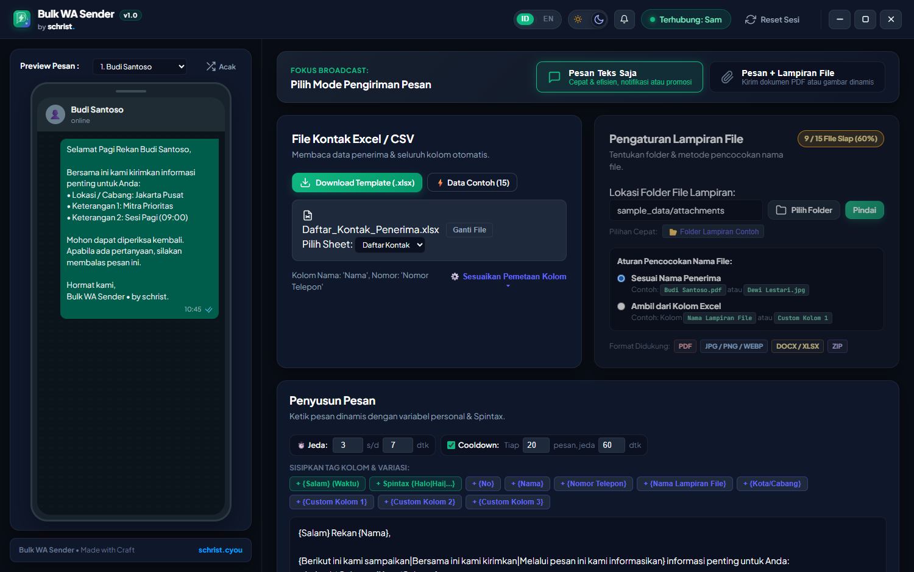
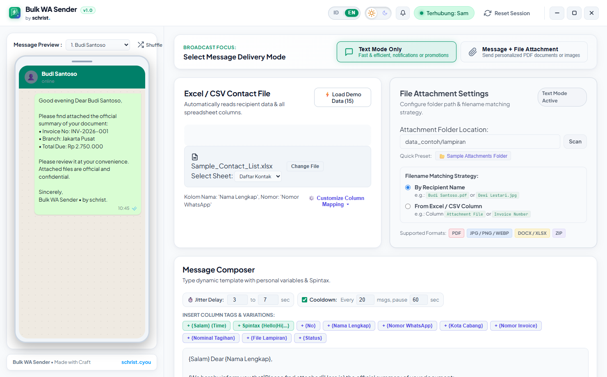
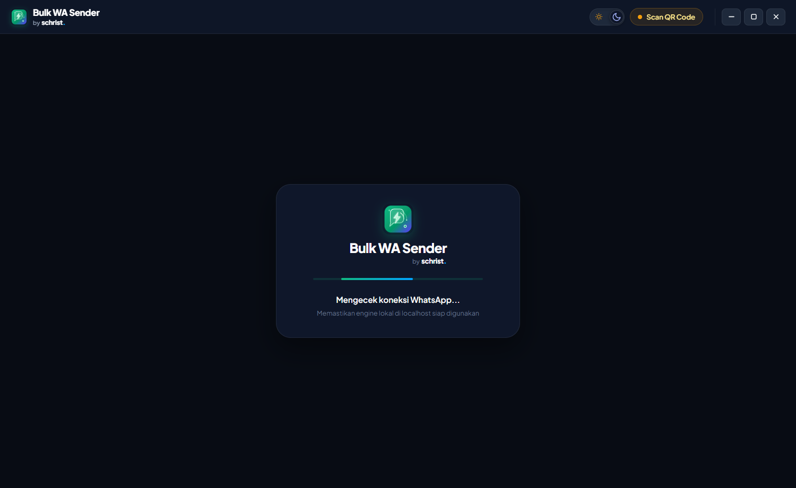
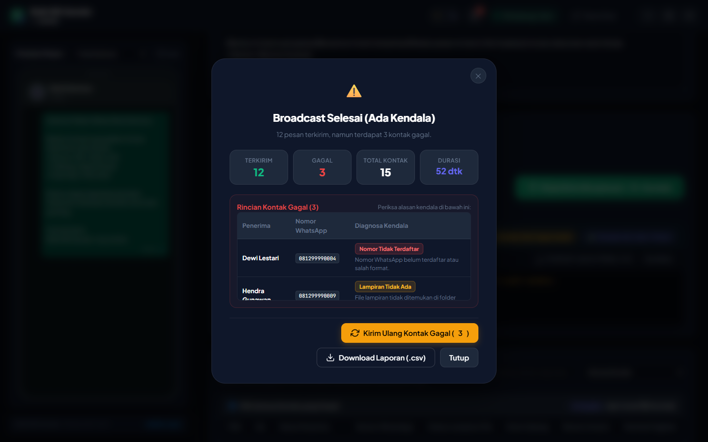
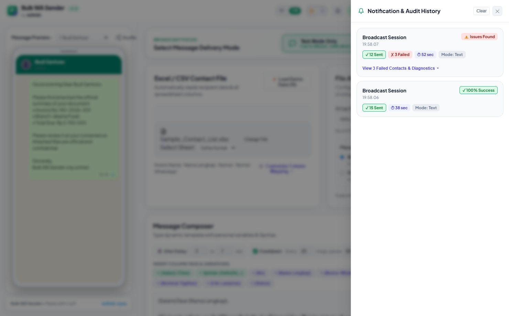
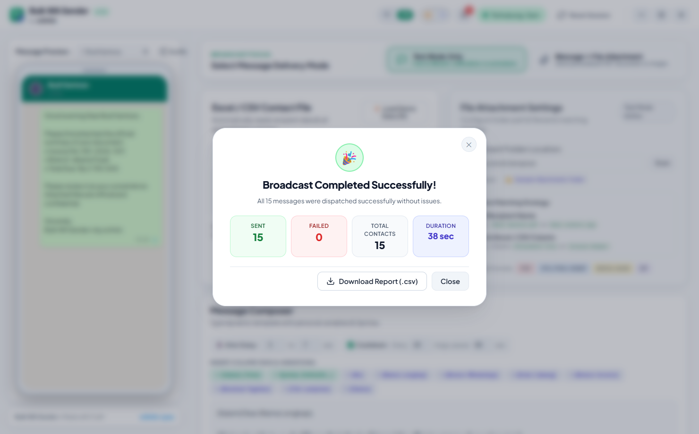

<div align="center">

  <h1>⚡ Bulk WA Sender (Rust Core Edition)</h1>
  <p><strong>Aplikasi Desktop Otomasi Pengirim WhatsApp Massal Berperforma Tinggi</strong></p>
  <p><em>Ditenagai Rust Core Native, Dynamic Attachment Matching, Spintax Anti-Ban, Custom Completion Modal, dan Audit Riwayat Kegagalan.</em></p>

  <p>
    
    
    
    
    
    
  </p>

  <p>
    <strong>Designed & Developed by <a href="https://schrist.cyou">schrist.</a></strong>
  </p>

</div>

---

## 📸 Preview Antarmuka

<div align="center">
  <h3>✨ Workspace Utama (Obsidian Emerald Theme)</h3>
  
  <br/><br/>
  
</div>

<br/>

<table align="center">
  <tr>
    <td align="center" width="50%">
      <strong>🛡️ Two-View Gateway (Loading & QR Scan)</strong><br/><br/>
      
    </td>
    <td align="center" width="50%">
      <strong>🔔 Modal Notifikasi Hasil & Diagnosa Kendala</strong><br/><br/>
      
    </td>
  </tr>
  <tr>
    <td align="center" width="50%">
      <strong>📑 Flyout Drawer Riwayat Notifikasi & Audit</strong><br/><br/>
      
    </td>
    <td align="center" width="50%">
      <strong>🎉 100% Sukses Modal (Light Mode)</strong><br/><br/>
      
    </td>
  </tr>
</table>

---

## 🌟 Fitur Utama

### 1. ⚡ Arsitektur Hybrid: Tauri v2 Rust Core + Node.js Engine
- **Performa Native Rust**: Pengolahan dataset Excel/CSV puluhan ribu baris dan pemindaian file lampiran dilakukan di tingkat memori binary Rust (`calamine` & `walkdir`).
- **Sidecar WhatsApp Tanpa Jendela**: Engine otomasi berjalan di latar belakang secara hening (`CREATE_NO_WINDOW`) tanpa membebani memori CPU.
- **Konsumsi Memori Ringan**: Membawa efisiensi Tauri v2 dengan konsumsi RAM yang jauh lebih hemat dibanding Electron konvensional.

### 2. 🛡️ Two-View Secure Gateway
- **Tampilan 1 (Gateway Terpusat)**: Saat aplikasi dibuka, sistem otomatis mengecek sesi WhatsApp. Jika belum terhubung, antarmuka menyajikan layar terpusat dengan instruksi jelas dan QR Code yang tajam.
- **Tampilan 2 (Workspace 2-Kolom)**: Begitu scan QR berhasil, aplikasi otomatis mengalihkan pengguna ke workspace utama. Dilengkapi tombol **Reset Sesi** di titlebar untuk berganti akun kapan saja.

### 3. 📎 Dynamic Smart Attachment Matching
- **Pemindaian Fleksibel**:
  - *Berdasarkan Nama Penerima*: Mencocokkan nama kontak dari Excel dengan file di folder sumber (misal `Budi Santoso.pdf`, `Budi Santoso.jpg`).
  - *Berdasarkan Kolom Excel*: Menggunakan referensi nomor invoice, ID unik, atau nama file spesifik.
- **Dukungan Multi-Format**: PDF, JPG, PNG, WEBP, DOCX, XLSX.
- **Verifikasi Pra-Kirim (Pre-Flight)**: Indikator visual hijau/merah di tabel kontak untuk memastikan semua lampiran tersedia sebelum tombol broadcast ditekan.

### 4. 💬 Dynamic Interpolation & Spintax Engine (Anti-Ban)
- **Tag Kolom Dinamis**: Masukkan `{Nama Lengkap}`, `{Kota Cabang}`, `{Nomor Invoice}`, `{Nominal Tagihan}` ke dalam template pesan dengan 1 klik.
- **Salam Berdasarkan Waktu**: Variabel `{Salam}` otomatis menyesuaikan menjadi *Selamat Pagi*, *Selamat Siang*, *Selamat Sore*, atau *Selamat Malam*.
- **Spintax Acak**: Gunakan format `{Halo|Hai|Selamat Siang}` untuk memvariasikan isi pesan ke setiap kontak guna mencegah deteksi spam WhatsApp.
- **Format Rupiah Otomatis**: Angka nominal otomatis diformat ke Rupiah standar Indonesia (`Rp 2.750.000`).

### 5. ⏱️ Anti-Ban Smart Timing & Batch Cooldown
- **Randomized Jitter Interval**: Delay acak antara pengiriman pesan (default: 3 - 7 detik).
- **Cooldown Batch Pause**: Jeda otomatis setelah sejumlah pesan terkirim (contoh: jeda 60 detik setiap 20 pesan) agar ritme menyerupai pengetikan manusia asli.
- **Kontrol Penuh**: Tombol *Jeda*, *Lanjutkan*, dan *Berhenti Manual* siap digunakan kapan saja.

### 6. 🔔 Custom Material Design 3 Modal & Audit Flyout Drawer
- **Bukan Alert Bawaan Browser**: Seluruh notifikasi dikemas dalam modal dialog Obsidian Emerald yang elegan.
- **Diagnosa Cerdas Kontak Gagal**:
  - 🔴 *Nomor Tidak Terdaftar*: Akun WA tujuan tidak aktif / format nomor keliru.
  - 🟡 *Lampiran Tidak Ada*: File tidak ditemukan di direktori sumber.
  - 🟣 *Ukuran Terlalu Besar*: File melampaui batas transmisi media WhatsApp.
  - 🌐 *Koneksi Terputus*: Gangguan jaringan / timeout server sidecar.
- **1-Click Retry Failed**: Tombol kirim ulang otomatis memilih hanya kontak yang gagal dan memfilternya di tabel.
- **Drawer Riwayat di Title Bar**: Ikon lonceng dengan unread counter badge dan histori lengkap tersimpan di `localStorage`.

### 7. 🎨 Obsidian Emerald M3 Aesthetic
- UI modern berbasis Material Design 3 dengan nuansa warna *Obsidian Emerald* (`#059669`).
- Switcher tema *Light* & *Dark* instan dengan dukungan navigasi keyboard (`ArrowLeft` / `ArrowRight`).
- Window controls custom yang bersih (Minimize, Maximize, Close).

---

## 🏗️ Arsitektur Sistem

```
┌─────────────────────────────────────────────────────────────┐
│                       DESKTOP CLIENT                        │
│                                                             │
│   ┌─────────────────────────────────────────────────────┐   │
│   │             Tauri v2 Frontend (WebView2)            │   │
│   │      HTML5 • CSS3 (Obsidian Emerald) • ES6 JS       │   │
│   └──────────────────────────┬──────────────────────────┘   │
│                              │ IPC (tauriCore.invoke)       │
│   ┌──────────────────────────▼──────────────────────────┐   │
│   │                 Rust Core Backend                   │   │
│   │   • Fast Excel Parser (calamine)                    │   │
│   │   • Fuzzy File Scanner (walkdir)                    │   │
│   │   • Sidecar Auto-Launcher & Native Window Controls  │   │
│   │   • Native URL Protocol Handler (rundll32 url.dll)  │   │
│   └──────────────────────────┬──────────────────────────┘   │
│                              │ Local HTTP REST (:3847)      │
│   ┌──────────────────────────▼──────────────────────────┐   │
│   │            WhatsApp Engine (Node.js Sidecar)        │   │
│   │   • Baileys / whatsapp-web.js (Headless Chromium)   │   │
│   │   • Local Session Isolation (.wa_session)           │   │
│   │   • Anti-Ban Queue Controller & Realtime Progress   │   │
│   └─────────────────────────────────────────────────────┘   │
└─────────────────────────────────────────────────────────────┘
```

---

## 📁 Struktur Direktori

```
Bulk_WA_Rust/
├── data_contoh/                  # Data uji coba (Excel kontak & berkas lampiran)
│   ├── Daftar_Kontak_Penerima.xlsx
│   ├── Daftar_Kontak_Penerima.csv
│   └── lampiran/                 # Contoh file PDF, JPG, PNG, DOCX
├── docs/                         # Dokumentasi & aset visual
│   ├── screenshots/              # Cuplikan antarmuka aplikasi
│   ├── PANDUAN.md                # Panduan teknis penggunaan
│   └── ANALISIS_DAN_PENGEMBANGAN.md
├── scripts/                      # Script helper & generator screenshot
├── sidecar/                      # Node.js WhatsApp Engine
│   ├── server.js                 # HTTP REST API server otomasi WA
│   └── package.json
├── src-tauri/                    # Source code Rust backend Tauri v2
│   ├── src/
│   │   ├── main.rs
│   │   ├── lib.rs                # Registry command Tauri & sidecar controller
│   │   ├── excel.rs              # Engine parser Excel/CSV berkecepatan tinggi
│   │   └── attachment.rs         # Pemindai dan pencocok lampiran
│   ├── Cargo.toml
│   └── tauri.conf.json
├── ui/                           # Antarmuka pengguna (Frontend)
│   ├── index.html                # Struktur 2-tampilan (Gateway & Workspace)
│   ├── style.css                 # Sistem desain token Obsidian Emerald M3
│   ├── app.js                    # Controller utama, Spintax, modal & drawer
│   └── assets/                   # SVG Icons & SheetJS fallback
├── .gitignore                    # Konfigurasi proteksi keamanan commit
├── Jalankan_Aplikasi.bat         # Launcher 1-klik untuk pengguna Windows
└── README.md                     # Dokumentasi utama proyek
```

---

## 🚀 Panduan Menjalankan & Membangun

### Prasyarat
1. **Windows 10 / 11 (64-bit)**
2. **Node.js** (v18.0.0 atau lebih baru)
3. **Rust & Cargo** (1.75.0 atau lebih baru)
4. **Build Tools C++** (Microsoft C++ Build Tools atau Visual Studio)

### 1. Clone Repository
```bash
git clone https://github.com/samuelchrist12/whatsapp-bulk-rust.git
cd whatsapp-bulk-rust
```

### 2. Pasang Dependensi Sidecar
```bash
cd sidecar
npm install
cd ..
```

### 3. Mode Pengembangan (Development)
Untuk menjalankan aplikasi dalam mode live-reload:
```bash
cd src-tauri
cargo tauri dev
```
*Atau jalankan file batch instan: `Jalankan_Aplikasi.bat`.*

### 4. Build Binary Produksi (.exe)
Untuk mengompilasi binary standalone siap distribusi:
```bash
cd src-tauri
cargo build --release
```
Binary hasil kompilasi akan berada di: `src-tauri/target/release/Bulk_WA_Sender.exe`.

---

## 🛡️ Keamanan & Privasi

1. **Penyimpanan Lokal (Zero Cloud Storage)**: Semua sesi WhatsApp, data kontak, pesan, dan lampiran disimpan 100% secara lokal di komputer pengguna.
2. **Kredensial Aman**: Folder sesi WhatsApp (`.wa_session` dan `.wwebjs_cache`) secara eksplisit diabaikan oleh `.gitignore` sehingga tidak akan pernah terunggah ke repositori publik.
3. **Anti-Ban Awareness**: Pengguna disarankan tetap bijak dalam menentukan interval delay dan jumlah kontak harian sesuai kebijakan WhatsApp Business.

---

## 👨‍💻 Kontributor & Lisensi

Dibuat dengan ❤️ oleh **[schrist.](https://schrist.cyou)**  
GitHub: [@samuelchrist12](https://github.com/samuelchrist12)

Proyek ini dilisensikan di bawah lisensi **[MIT License](LICENSE)**. Anda bebas menggunakan, memodifikasi, dan mendistribusikan perangkat lunak ini untuk keperluan komersial maupun pribadi.

